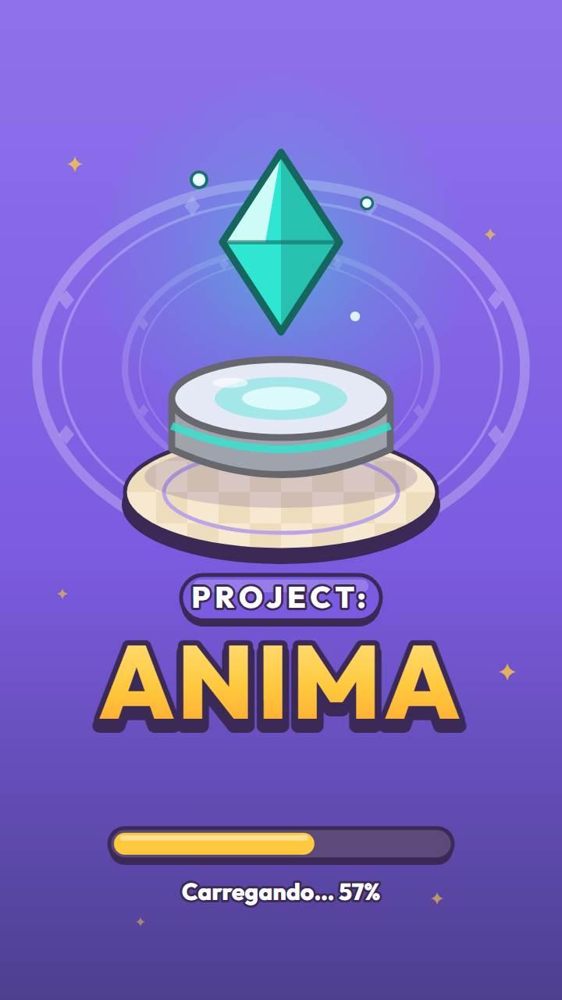
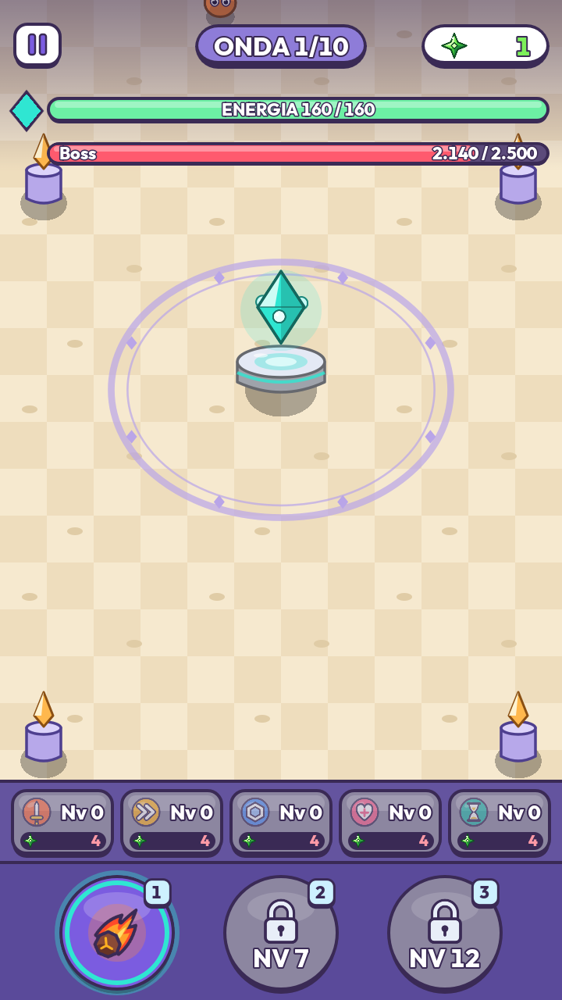
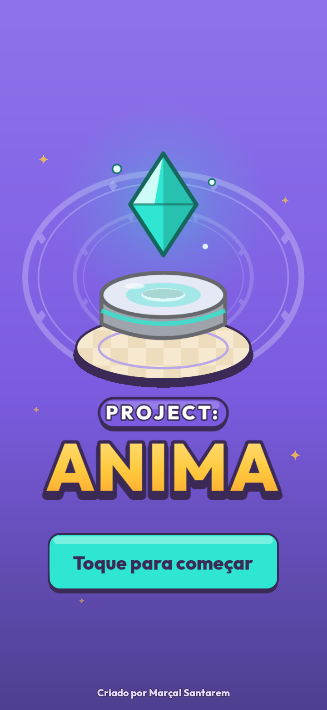
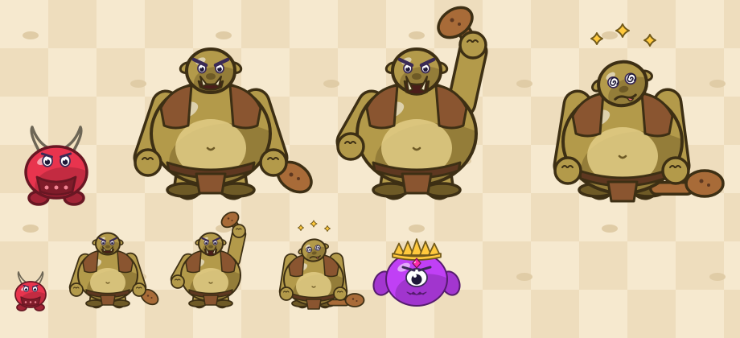
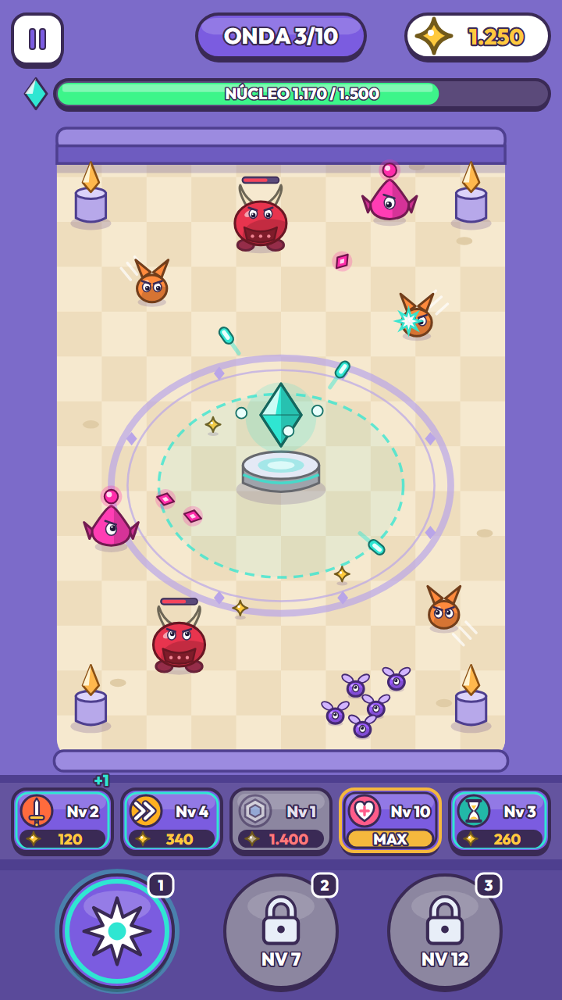

<div align="center">



# Project: Anima

**Um defense game de bullet hell com meta-RPG, feito para rodar no navegador e no iPhone.**

[](https://godotengine.org)
[](https://docs.godotengine.org/en/stable/tutorials/scripting/gdscript/)
[](#-como-jogar)
[](#-testes)
[](docs/marcos.md)

[**▶ Jogar a demo**](https://projectanimagame.netlify.app) · [Versão de desenvolvimento](https://dev--projectanimagame.netlify.app) · [Bíblia do projeto](docs/00_biblia_projeto.md)

</div>

---

## ✨ O jogo

Você é o **Anima**, um cristal flutuando sobre um pedestal, **parado no centro da arena**. Hordas de criaturas chegam de todos os lados. **Não há joystick nem movimento**: o Anima ataca sozinho, e o seu trabalho é decidir **o momento certo** de soltar o Módulo (o meteoro de fogo) e **onde investir as Partículas** que os inimigos deixam.

<div align="center">

&nbsp;&nbsp;

</div>

### Como funciona uma partida

- **10 ondas** de dificuldade crescente, com um novo tipo de inimigo a cada duas ondas, e o **chefe** na última. Uma partida dura de 3 a 10 minutos (~4 min jogando bem).
- O **ataque básico é automático** e mira no inimigo mais próximo.
- O **Módulo** é o seu poder ativo, com cooldown: o **meteoro de fogo** cai na maior concentração de inimigos e explode em área. Os outros dois slots abrem conforme o nível da conta (nos níveis 7 e 12).
- Cada inimigo morto dá **Partículas** (a moeda da partida). Elas pagam **5 upgrades em tempo real**, sem pausar o jogo: **Atk power, Atk spd, Defesa, Vida máxima e Cooldown**. Os upgrades valem só para a partida.
- A partida acaba se a **Energia** do Anima chegar a zero, ou quando você derrota o chefe.

### Os inimigos

| Inimigo | Papel |
|---|---|
| **Corredor** | rápido e frágil, chega primeiro |
| **Enxame** | muitos, pequenos e em grupo |
| **Tanque** | lento e resistente, com a vida contada na barrinha sobre ele |
| **Atirador** | fica longe e atira no Anima |
| **Chefe ogro** | grande, só ataca de perto e tem uma barra de **defesa** (veja abaixo) |

Todo inimigo comum tem uma **barra de vida** pequena sobre ele: **verde**, **amarela** abaixo de 60% e **vermelha** com 30% ou menos.

### O chefe

<div align="center">

</div>

O ogro tem uma **barra de defesa** que funciona como escudo na frente da vida. Enquanto ela existir, os tiros só tiram defesa. Quando ela se esgota, ele é **lançado para trás, em direção à borda do mapa**, fica atordoado e só então a vida sofre dano. O **meteoro lança o ogro na hora**. A vida dele aparece numa barra vermelha grande no topo da tela, com o rótulo **"Boss"**.

---

## 🎨 Visual

Tema **Cyber-Mystic em 2D cartoon casual**: colorido, formas arredondadas, contorno e sombra suave, câmera em 3/4 e uma interface com botões grandes feitos para o toque, em **modo retrato**. O Anima é um núcleo-objeto, já pronto para receber **skins**.

<div align="center">

</div>

O guia completo de arte está em [`docs/arte.md`](docs/arte.md), e os efeitos visuais em [`docs/vfx.md`](docs/vfx.md). O Archero é uma referência de **gênero, retenção e acabamento**; nenhuma arte, nome ou layout foi copiado.

---

## 🧭 O que vem por aí

| Marco | O que traz | Situação |
|---|---|---|
| **M1: Demo do combate** | 1 fase completa, visualmente polida, pronta para divulgar | em fechamento |
| **M2: Meta-jogo local** | nível de conta, mais Módulos, **Fragmentos** (equipamentos com fusão 3→1), save local | planejado |
| **M3: Backend** | conta, sincronização e economia validada no servidor | planejado |
| **M4: Monetização e lançamento** | rewarded ads, skins, loja e builds nativos | planejado |

**Vocabulário do jogo:** **Partículas** (moeda da partida, estrela verde), **Moeda** (moeda do meta-jogo, dourada), **Módulos** (os poderes ativos), **Fragmentos** (os equipamentos, 6 espaços) e **Núcleos** (os talentos). Os três últimos chegam no M2 em diante. Detalhes na [Bíblia do projeto](docs/00_biblia_projeto.md).

---

## 🎮 Como jogar

Abra a [demo no navegador](https://projectanimagame.netlify.app). Funciona no PC e no celular, **de preferência em retrato**.

| Plataforma | Controles |
|---|---|
| **Celular** | toque nos botões de Módulo e de upgrade |
| **PC** | clique, ou as teclas `1` `2` `3` para os Módulos; `Tab`, setas e `Enter` nos upgrades; `Esc` pausa |

---

## 🛠️ Para desenvolvedores

| Camada | Escolha |
|---|---|
| Engine | **Godot 4.x**, renderer **Compatibility** (WebGL 2) |
| Linguagem | **GDScript** (C# não exporta para a web) |
| Exportação | **Web, single-threaded**, sem SharedArrayBuffer; roda em qualquer hospedagem estática |
| Testes | **GUT** |
| Deploy | GitHub Actions → Netlify (`dev` publica a versão de teste; `main`, a oficial) |

```bash
# Abrir o editor
godot --editor --path .

# Testes (rode antes: godot --headless --path . --import)
godot --headless --path . -s addons/gut/gut_cmdln.gd -gexit

# Exportar para Web
godot --headless --path . --export-release "Web" build/web/index.html
```

> `godot` é o executável da versão 4.7.2, que não está no PATH nesta máquina. O guia de instalação está em [`docs/setup.md`](docs/setup.md).

### Estrutura

```text
src/
  core/       fluxo de cenas, configuração e resultado da partida
  match/      arena, Anima, inimigos, chefe, ondas, Módulos e upgrades
  fx/         efeitos visuais com pool (só reagem a sinais)
  ui/         HUD, telas, tema e componentes
data/         dados em Resources (.tres): inimigos, ondas, upgrades, Módulos
assets/       sprites, interface, fundos e fontes (com licenças registradas)
web/          shell HTML da exportação (splash e erro)
tests/        testes GUT e ferramentas de simulação
docs/         Bíblia, GDD, decisões, backlog, guias de arte, UI e VFX
```

As regras de dependência entre as pastas estão em [`docs/estrutura.md`](docs/estrutura.md). Os princípios principais:

- **Dados separados da lógica:** inimigos, ondas e upgrades vivem em `.tres` e podem ser ajustados sem tocar no código.
- **A partida não conversa com o backend:** ela produz um `MatchResult`, e o meta-jogo faz o resto.
- **Desempenho no Safari do iPhone** é o alvo: pools de projéteis e efeitos, sem alocação por quadro.

### 🧪 Testes

São **164 testes GUT** (unidade e integração) cobrindo ondas, dano, cooldowns, upgrades, chefe, barras de vida, efeitos, HUD e o fluxo de telas. Há também um **bot de simulação** que joga a fase inteira de forma acelerada para medir o balanceamento (hoje: chega ao chefe em 100% das partidas e vence em ~60%):

```bash
godot --headless --path . --fixed-fps 60 -s tests/tools/run_sim.gd -- --seeds=20
```

---

## 📚 Documentação

| Documento | Conteúdo |
|---|---|
| [`docs/00_biblia_projeto.md`](docs/00_biblia_projeto.md) | pitch, escopo, roadmap, glossário e time. **Comece por aqui** |
| [`docs/gdd.md`](docs/gdd.md) | GDD original |
| [`docs/decisoes.md`](docs/decisoes.md) | registro de decisões |
| [`docs/marcos.md`](docs/marcos.md) · [`docs/backlog.md`](docs/backlog.md) | marcos e tarefas |
| [`docs/gameplay.md`](docs/gameplay.md) · [`docs/meta.md`](docs/meta.md) | regras e números da partida e dos upgrades |
| [`docs/ui.md`](docs/ui.md) · [`docs/arte.md`](docs/arte.md) · [`docs/vfx.md`](docs/vfx.md) | interface, arte e efeitos |
| [`docs/arquitetura.md`](docs/arquitetura.md) · [`docs/estrutura.md`](docs/estrutura.md) | arquitetura e pastas |
| [`docs/git-workflow.md`](docs/git-workflow.md) | branches, commits e PRs |

---

## 🤝 Como o projeto é feito

O Project: Anima é desenvolvido por uma **equipe de agentes de IA coordenados por um líder de projeto**, sob a direção do dono do projeto: gameplay, UI/web, arte, VFX, meta-jogo, arquitetura e QA. O fluxo de trabalho e os papéis estão na [Bíblia](docs/00_biblia_projeto.md) e em [`docs/agentes/`](docs/agentes/).

- Todo o desenvolvimento acontece na branch **`dev`**; a **`main`** é protegida e só recebe mudanças por **Pull Request**.
- Documentação, commits e conversa em **português (pt-BR)**; identificadores de código em inglês.

---

<div align="center">

**Criado por Marçal Santarem** · Feito com Godot 4 🧿

</div>
